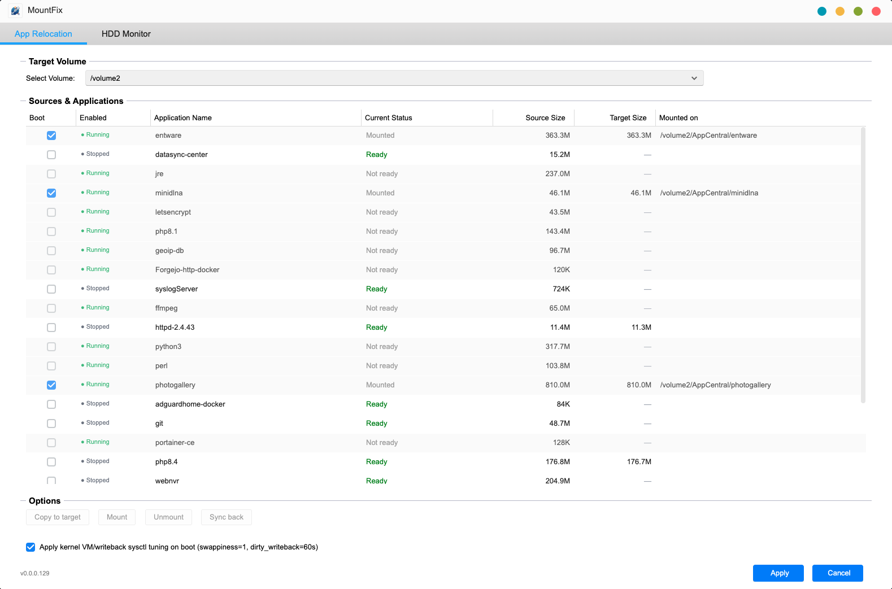
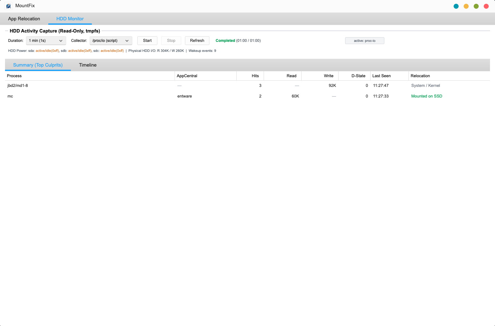
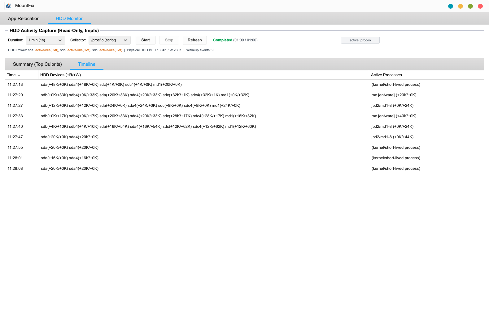

# MountFix for ASUSTOR ADM

A custom ASUSTOR ADM plugin that transparently relocates AppCentral applications from the default `/volume1` HDD storage to a faster SSD/NVMe volume (e.g. `/volume2`) using Linux `mount --bind`.

---

## How It Works & Design Assumptions

ASUSTOR ADM always installs AppCentral packages under `/volume1/.@plugins/AppCentral/<app>` (with `/usr/local/AppCentral/<app>` symlinked there) and does not let users pick a different volume. When `/volume1` is a mechanical HDD, I/O-heavy applications such as `docker-ce`, `photogallery`, or `download-center` suffer from slow disk latency.

MountFix solves this without modifying ADM or reconfiguring applications:

1. **Copy to target** — `rsync` copies `/volume1/.@plugins/AppCentral/<app>` to `/volumeX/AppCentral/<app>`.
2. **Bind-mount** — `mount --bind /volumeX/AppCentral/<app> /volume1/.@plugins/AppCentral/<app>` overlays the SSD directory onto the original path. ADM and the app keep using their standard paths while all reads/writes hit the SSD.
3. **Boot & shutdown persistence** — ADM init scripts (`S02MountFix` / `K02MountFix`) automatically re-establish bind mounts at boot *before* relocated apps start and detach them cleanly at shutdown *after* apps stop.

Key assumptions:
- **SSD/NVMe target required:** The UI detects block-device rotational flags (SATA/SAS RAID and NVMe/MMC) and blocks HDD volumes from being selected as targets.
- **HDD fallback copy is preserved:** MountFix keeps the original `/volume1/.@plugins/AppCentral/<app>` directory underneath the bind mount. Use **Sync back** to mirror newer SSD data back to `/volume1` before reverting or changing disks.
- **Apps must be stopped before any operation:** Copy, Mount, Unmount, and Sync-back are only safe while the target application is stopped in AppCentral.

---

## Boot & Shutdown Integration (`S02MountFix` / `K02MountFix`)

ADM registers `CONTROL/start-stop.sh` at boot/stop priority `2`:

```text
Boot (rcS.pluginsfs):
  S02MountFix  ->  S20download-center  ->  S50minidlna / S50photogallery  ->  S52entware  ->  S65docker-ce

Shutdown (rcK.pluginsfs, reverse order):
  K80...  ->  K52entware  ->  K35docker-ce  ->  ...  ->  K02MountFix  ->  built-in services (sshd, S21stormand)
```

Because `S02MountFix` runs **before** `S52entware` (and `K02MountFix` runs **after** `K52entware` removes `/opt/bin`), the boot/shutdown path is completely **`jq`-free**:
- `etc/mountfix.conf` (JSON) is the UI source of truth.
- `etc/mounts.list` (`<src>:<tgt>` per line) is atomically generated on every UI save/mount/unmount and during package upgrade (`CONTROL/post-install.sh`), and read with pure POSIX `sh` at boot/shutdown.

### Runtime Stop/Upgrade vs. Real Reboot/Shutdown

MountFix distinguishes normal runtime stops from actual system power events via ADM's `/var/log/halt-action`:

- **Normal runtime (AppCentral Stop / Disable / Upgrade):** Attempts a plain, non-lazy `umount`. If an app is still running and holds files open, MountFix **never kills processes and never uses lazy `umount -l`** — it logs a warning with exact `pid(comm)` holders and leaves the mount intact so running services (e.g. Docker containers) continue uninterrupted.
- **Real system `REBOOT` or `SHUTDOWN`:** Unmounts idle apps in reverse order (~1 s). If lingering processes (such as an SSH `bash`/`tmux` session on `entware`) still hold a mount after the grace window, MountFix sends `SIGTERM` → `SIGKILL` **only to the exact per-path PIDs** found under `/proc` (never `fuser -k -m`) so ADM's `S21stormand` can cleanly unmount `/volume2` and `/volume1`.

---

## Features — What MountFix Does (and When)

| Feature | When It Runs | What It Does |
|---|---|---|
| **Copy to target** | User clicks **Copy to target** | Runs a detached background `rsync` (`-aH --numeric-ids` + auto-probed `-A`/`-X`/`--outbuf=L`) from `/volume1` to `<target>/AppCentral/<app>`. If the target folder already exists, prompts before running mirror mode (`--delete`). |
| **Mount** | User clicks **Mount** | Verifies no processes hold the app directory (`pids_using_paths`), executes `mount --bind`, and atomically adds the app to `etc/mountfix.conf` and `etc/mounts.list`. |
| **Unmount** | User clicks **Unmount** | Prompts for **Unmount & Sync-back** (recommended) or **Unmount only**. Detaches the bind mount and atomically removes the app from `etc/mountfix.conf` and `etc/mounts.list`. |
| **Sync back** | User clicks **Sync back** (or **Unmount & Sync-back**) | Mirrors `<target>/AppCentral/<app>/` back to `/volume1/.@plugins/AppCentral/<app>/` using `--delete` (after explicit confirmation) so the HDD copy becomes identical to the SSD copy. |
| **Delete target** | User clicks **Delete target** | Reclaims SSD space by permanently removing `<target>/AppCentral/<app>` only when the app is stopped, unmounted, and removed from boot config. Runs a read-only `rsync --dry-run` diff preview first, offers **Sync back & Delete target** when SSD differences exist, requires explicit checkbox confirmation (and server-side `confirm=<app>`), and refreshes volume free space. |
| **Validation & mismatch warnings** | On window open, volume change, or after per-app actions | Non-blocking single-pass `du -sk` disk usage check + `stat -c %d:%i` mount verification. Flags any `configured != mounted` mismatch in the grid (`Mounted (not in boot)` / `Not mounted (in boot)`). Action buttons in **Options** are temporarily disabled while validation is in flight so actions never run against stale state. |
| **Optional `sysctl` tuning** | At boot / `start-stop.sh start` (only if enabled) | Controlled by the **Apply kernel VM/writeback sysctl tuning on boot** checkbox (`enableSysctlTuning`, **off by default**). When enabled, logs previous values and sets `vm.swappiness=1`, `vm.vfs_cache_pressure=10`, `vm.dirty_writeback_centisecs=6000`, `vm.dirty_expire_centisecs=6000`. |
| **Uninstall guard** | Package uninstall (`CONTROL/pre-uninstall.sh`) | Scans `/proc/mounts` and **blocks uninstall** (`exit 1`) if any AppCentral bind mount is still active, listing the mounted apps. |
| **HDD Activity Monitor** | User opens the **HDD Monitor** tab and clicks **Start** (`30s`–`12h`) | Runs a read-only background observer in `tmpfs` (`/tmp`) that tracks physical HDD `/proc/diskstats` deltas, queries drive power state via `hdparm -C` (without waking standby drives), and attributes I/O to processes and AppCentral packages using `iotop-static` (with automatic or selectable `/proc/<pid>/io` fallback) and `st_dev` correlation. |
| **Security & logging** | Every CGI request & boot/shutdown | Every CGI verifies a valid ADM **administrator** session (`sid` via `admin.cgi`) and enforces `POST` on mutating endpoints. Boot/shutdown actions log to `var/mountfix.log` (auto-rotated) and emit warnings to ADM System Log. |

---

## What MountFix Does NOT Do

- **Does not stop or start applications for you.** You must stop and start applications manually in AppCentral.
- **Does not auto-sync-back** on shutdown, reboot, MountFix upgrade, or when you disable MountFix.
- **Does not delete target folders** on the SSD automatically when you unmount an app (use the explicit **Delete target** action after verifying the app works on `/volume1`).
- **Does not allow relocating `MountFix` itself** (blocked both in the UI and server-side).
- **Does not allow selecting HDD volumes** as migration targets.
- **Does not modify or restore `sysctl` on `stop`/shutdown.**

---

## User Guide & Rules (What You Can and Cannot Do)

### Relocating an Application (HDD → SSD)
1. Open **AppCentral** and **stop** the target application.
2. Open **MountFix** (**App Relocation** tab), select your SSD/NVMe **Target Volume**, and select the application row.
3. Click **Copy to target** and wait for `100%` completion.
4. Click **Mount** (this mounts the app immediately and saves it to boot configuration automatically).
5. Return to **AppCentral** and **start** the application.



### Moving an Application Back to HDD (SSD → HDD)
1. Open **AppCentral** and **stop** the application.
2. Open **MountFix**, select the application, and click **Unmount**.
3. Choose **Unmount & Sync-back** so the latest SSD data is mirrored back to `/volume1`.
4. Return to **AppCentral** and **start** the application.
5. *(Optional)* Once verified on HDD, stop the app again and click **Delete target** in MountFix to inspect any remaining differences and reclaim SSD space.

---

## HDD Monitor — Diagnosing HDD Wakeups & Disk I/O

The **HDD Monitor** tab helps you find out **which processes or AppCentral applications are still reading/writing to mechanical HDDs** (preventing disk hibernation/standby) and whether those apps can be relocated to SSD.

### How It Works
- **Read-only & zero HDD wakeups:** The background worker runs at low priority (`nice 10`) and keeps all locks, state files, and reports strictly in RAM (`tmpfs` under `/tmp`). Reading `/proc` and `/sys` never touches physical disks, and per-PID file-descriptor inspection runs *only* during samples where `/proc/diskstats` confirms physical HDD I/O occurred.
- **Duration presets (`30s`–`12h`):** Adaptive sampling intervals (`1s` for `30s`–`1m`, `3s` for `5m`–`20m`, `5s` for `30m`–`1h`, and `10s` for `2h`–`12h`) keep CPU usage low even on overnight captures. You can close MountFix or your browser while a long capture runs and reopen it later to view live progress or the finished report.
- **Selectable I/O collectors:**
  - **Auto (`iotop-static`)** *(recommended)*: Uses the bundled static `x86-64` `iotop-c 1.31` binary (via Linux Netlink `taskstats`) for very low CPU overhead, kernel-thread I/O (`jbd2`), and better detection of short-lived processes. Automatically falls back to `/proc/io` if unavailable or on non-`x86-64` architectures.
  - **`/proc/io (script)`**: Zero-dependency POSIX collector reading `/proc/<pid>/io` deltas + `D`-state.
- **HDD vs. SSD separation:** Automatically discovers physical `rotational == 1` drives, their partitions, and rotational `md*` RAID arrays, then correlates active PIDs' open file descriptors (`st_dev`) against HDD mountpoints (`/` on `md0`, `/volume1` on `md1`, etc.) so SSD-only containers and apps are filtered out.

### How to Interpret Results

1. **Header status bar:**
   - **HDD Power:** Drive power state from `hdparm -C` (updated on start, every ~60s on long captures, and on completion without waking standby drives) — `standby` (green) means spun down; `active/idle` (amber) means awake.
   - **Physical HDD I/O & Wakeup events:** Total KB read/written across physical rotational disks and how many sampling intervals recorded HDD activity.
2. **Summary (Top Culprits) tab:** Aggregates every process that touched HDD during the capture, sorted by hit count and I/O volume.

   

   | Relocation Badge | Meaning | Recommended Action |
   |---|---|---|
   | **Still on HDD — can relocate** *(amber)* | AppCentral package currently running from `/volume1` HDD. | Switch to **App Relocation** to move it to SSD. |
   | **Mounted on SSD** *(green)* | AppCentral package is already relocated to SSD, but accessed user files on an HDD share (e.g. `mc` from `entware` browsing `/volume1`). | Normal when accessing HDD data; no relocation needed. |
   | **System / Kernel** *(gray)* | ADM system daemon (`logmand`, `lighttpd`) or kernel thread (`jbd2/md1-8` ext4 journal flush, `md1_raid*`). | Check Timeline to see what triggered the flush (often `md0`/`sd*2` system logs or `md1`/`sd*4` data writes). |

3. **Timeline tab:** Chronological log (capped at the latest 200 events) showing exact timestamps, per-device `+R/+W` deltas, and active processes.

   

   - **`sd*2` / `md0`** corresponds to ADM's system root partition (`/`).
   - **`sd*4` / `md1`** corresponds to the primary HDD data volume (`/volume1`).
   - **`(kernel/short-lived process)`** means either a kernel metadata/journal operation with no userspace I/O or a very short process that exited before the sample finished.

### Important Rules & Awareness
- **Always stop the app first:** Attempting to copy, mount, unmount, or sync-back a running app is blocked by both the UI and the backend (`pids_using_paths` check) to prevent database or filesystem corruption.
- **Understand mirror mode (`--delete`):** Both **Sync back** and **Copy to target** (when overwriting an existing target directory) use `rsync --delete`. Files removed on the source side will also be removed on the destination side.
- **Be careful with `entware`:** `entware` provides `jq`, `bash`, and `rsync` used by MountFix and starts *after* `S02MountFix`. MountFix displays an explicit warning before copying or mounting `entware`.
- **Disabling MountFix in AppCentral:** Disabling or upgrading MountFix while relocated apps are running will **not** crash or unmount them; they stay mounted on SSD until the next reboot (after which a disabled MountFix will not re-mount them).
- **Before uninstalling MountFix:** You **must** stop, unmount, and sync-back all relocated apps first. `pre-uninstall.sh` will refuse to uninstall MountFix while any bind mount is active.
- **Keep backups:** Always maintain independent backups of critical application data (databases, Docker volumes, photos) before relocating or syncing back.
- **Kernel `sysctl` tuning caveat:** Enabling `enableSysctlTuning` extends kernel dirty writeback timers to 60 seconds system-wide (reducing disk wakeups, but increasing the window of unflushed RAM writes on sudden power loss — recommended only with a UPS).

---

## Prerequisites & Local Build

- **On NAS (runtime):** Installed **Entware** (`opkg`). `CONTROL/pre-install.sh` adds Entware to `PATH` and checks `jq`, `bash`, and `rsync` independently, installing any missing tools via `opkg`.
- **Local development & packaging:** Requires `jq`, `tar`, and `zip`.
  - `./build.sh` — packages the current version from `CONTROL/config.json` into `./out/` without dirtying tracked files.
  - `./build.sh --bump` — increments the revision in `CONTROL/config.json` before packaging.
  - `./tests/run_all.sh` — runs all 10 behavioural and build verification test suites.

---

## Developer Reference

- **APKG Layout:** `CONTROL/` (manifest, lifecycle hooks, `lib.sh`, `start-stop.sh`), `webman/` (POSIX `sh` CGIs, `scripts/common.sh`, ExtJS 4 UI `mf_actions.js` / `mf_core.js` / `mf_main.js` bundled into `mountfix.js`), `etc/` (`mountfix.conf`, generated `mounts.list`).
- **CGI API:** All endpoints require a valid ADM administrator `sid`; mutating actions require `POST`.
  - `GET config.cgi?act=get` — returns current config, installed apps (excluding `MountFix`), volumes (SSD/HDD + free space), and package version.
  - `POST config.cgi?act=set` — validates and saves `{targetVolume, selectedApps, enableSysctlTuning}` and regenerates `etc/mounts.list`.
  - `GET validate.cgi?act=get&target=VOL[&app=NAME]` — returns per-app mount state, `configured`/`mismatch` flags, and batched `du -sk` sizes.
  - `POST mount.cgi?act=mount|unmount&app=NAME&target=VOL` — binds/unbinds the app and atomically syncs boot configuration.
  - `POST migrate.cgi?act=migrate|sync_back&app=NAME&target=VOL[&force=1]` / `GET migrate.cgi?act=status` — starts or polls detached background `rsync` transfers protected by `/tmp/mountfix.lock`.
  - `GET migrate.cgi?act=delete_preview&app=NAME&target=VOL` / `POST migrate.cgi?act=delete_target&app=NAME&target=VOL&confirm=NAME` — inspects SSD vs. HDD differences (`rsync --dry-run`) and safely removes `<target>/AppCentral/<app>` under `/tmp/mountfix.lock`.
  - `POST diskwatch.cgi?act=start&duration=SEC[&collector=MODE]` / `POST diskwatch.cgi?act=stop` / `GET diskwatch.cgi?act=status` — controls and polls the read-only HDD Activity Monitor (`30`s up to `43200`s / `12h`).
- **Additional Documentation:**
  - [docs/ARCHITECTURE.md](docs/ARCHITECTURE.md) — internal IPC, transfer engine, lock protocol, and boot/shutdown lifecycle.
  - [docs/TECHNICAL-REVIEW.md](docs/TECHNICAL-REVIEW.md) — full security/reliability audit, ADM 5.1.5 field verification, and Stage 1–2 implementation history.
  - [IDEAS.md](IDEAS.md) — future roadmap (Safe *Delete target* workflow and optional `validate.cgi` caching).

---

## Disclaimer & License

> **Use this software at your own risk.** MountFix performs low-level bind-mount, file-mirroring (`rsync --delete`), and optional Linux kernel (`sysctl`) operations. It is provided *"as is"*, without warranty of any kind. The author is not liable for any data loss, system instability, service downtime, or hardware damage. Future ASUSTOR ADM updates may alter how AppCentral or volumes operate.

Licensed under the **MIT License**.
