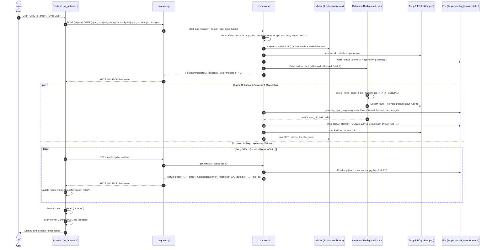

# MountFix Technical Architecture

This document describes the internal architecture, IPC mechanisms, and data flows of MountFix for ASUSTOR ADM.

---

## 1. Data Migration & Sync-Back Flow

MountFix allows copying and synchronizing application directories between the default storage volume (`/volume1/.@plugins/AppCentral/<app>`) and designated target volumes (such as fast NVMe/SSD storage at `/volumeX/AppCentral/<app>`).

Two primary transfer directions exist:
1. **Migration (HDD -> SSD):** Copies application data from `/volume1` to the target volume before establishing a bind-mount. When overwriting an existing target directory (`force=1`), runs in mirror mode (`--delete`) after explicit user confirmation.
2. **Sync-Back (SSD -> HDD):** Mirrors application data from the SSD volume back to the original `/volume1` storage (`--delete`) before maintenance, uninstallation, or volume restructuring, after explicit user confirmation.

### 1.1 Sequence Diagram



---

## 2. IPC & Progress Tracking Mechanism

### 2.1 Temporary Files and Paths

All transient IPC and lock paths live under `${TMPDIR:-/tmp}` (overridable via environment variables in tests):

| File Path | Type | Purpose |
| :--- | :--- | :--- |
| `/tmp/mountfix_transfer.status` | Plain Text | Atomically updated status file holding the app name, live rsync progress lines, and final `DONE` / `ERROR` marker. |
| `/tmp/mountfix.lock/` | Directory Mutex | Atomic global transfer lock (`mkdir`) containing `pid` and `owner` files, with stale-PID recovery. |
| `/tmp/mountfix_xfer.XXXXXX/progress.pipe` | Temp FIFO (`mktemp -d`) | Per-transfer named pipe capturing `rsync` stdout/stderr; removed automatically on subshell `EXIT`. |
| `/tmp/mountfix_mount.XXXXXX`, `/tmp/mountfix_umount.XXXXXX` | Temp File (`mktemp`) | Per-call stderr capture for `mount --bind` and `umount`; removed immediately after reading. |

### 2.2 Non-Blocking Subshell & Unbuffered Progress Streaming

1. **Detached Background Execution:** `_launch_rsync_transfer()` redirects all standard descriptors on the background subshell (`( ... ) </dev/null >/dev/null 2>&1 &`) and ignores `SIGHUP` (`trap '' HUP`), so `migrate.cgi`'s `$(...)` command substitution and `lighttpd` return immediately instead of blocking until `rsync` finishes.
2. **Unbuffered CR → LF Normalization:** `rsync --info=progress2` emits carriage returns (`\r`) to update progress in place. When available, `detect_rsync_flags()` adds `--outbuf=L`, and `_stream_rsync_progress()` converts `\r` to `\n` without pipe block-buffering stalls:
   - Uses `stdbuf -oL tr '\r' '\n' | awk '/[^ \t]/ { print; fflush() }'` when `stdbuf` is installed.
   - Falls back to a pure `awk` reader (`RS = "\r"` with `fflush()`) when `stdbuf` is absent.

### 2.3 Status File Lifecycle

The status file (`/tmp/mountfix_transfer.status`) follows a two-part layout:
- **Line 1:** Target application name (e.g., `Nextcloud`).
- **Subsequent lines / Last non-empty line:** Ongoing rsync progress lines or final state marker.

1. **Initialization (atomic write via `_write_status_atomic`):**
   ```text
   Nextcloud
   0% | Starting transfer...
   ```
2. **In-Flight Updates:** Continuous flushed progress lines appended from `_stream_rsync_progress < "$pipe" >> "$STATUS_FILE"`, e.g.:
   ```text
   Nextcloud
   10,485,760   15%   12.50MB/s    0:00:05
   25,165,824   36%   14.20MB/s    0:00:03
   ```
3. **Completion or Failure (atomic write *after* `wait "$rsync_pid"`):**
   ```sh
   if [ "$rsync_status" -eq 0 ]; then
       _write_status_atomic "$app_name" "DONE | 100% | Completed"
   else
       _write_status_atomic "$app_name" "ERROR | ${fail_prefix} (exit code: ${rsync_status})"
   fi
   ```

### 2.4 Status Extraction (`get_transfer_status_json`)

When `migrate.cgi?act=status` is invoked, `get_transfer_status_json()` in `webman/scripts/common.sh`:
- Returns `{"progress": 0, "state": "idle", "status": "idle", "pid": null}` if `$STATUS_FILE` does not exist.
- Reads line 1 (`app`) and the last non-empty line via `awk 'NF { line = $0 } END { print line }'`.
- Derives an explicit `state` from the last line prefix: `"DONE |"*` → `"done"` (`progress: 100`), `"ERROR |"*` → `"error"`, otherwise `"running"`.
- Reads `$TRANSFER_LOCK_DIR/pid` and includes it as `"pid"` only if the process is alive (`kill -0`), else `null`.
- Extracts the last percentage match with POSIX `awk` and emits a JSON-escaped response:
  ```json
  {"app": "Nextcloud", "state": "running", "progress": 36, "lastLine": "25,165,824   36%   14.20MB/s    0:00:03", "pid": 12345}
  ```

### 2.5 Frontend Polling (`mf_actions.js`)

Communication between backend and frontend relies on periodic **HTTP GET polling** rather than WebSockets or Server-Sent Events (SSE) to ensure full compatibility with ADM's lighttpd/CGI environment.

- **Trigger:** Method `page.monitorMigrationStatus(actionLabel, callbackOnComplete)`.
- **Interval:** Fixed at `500ms` via `setInterval()`.
- **UI Feedback:** Applies an ExtJS element mask (`page.win.el.mask()`) showing the live percentage.
- **Termination Conditions:**
  - `state === 'error'` or `lastLine` contains `"ERROR"`: Clears interval, unmasks UI, displays error message.
  - `state === 'done'` (matching the active app): Clears interval, unmasks UI, shows completion status, runs `validate()`, and triggers `callbackOnComplete`. Reaching `100%` while `state === 'running'` does **not** terminate early.
  - AJAX failure / network error: Clears interval, unmasks UI, alerts the user.

---

## 3. Safety Guardrails & Pre-conditions

Data transfer and mount operations enforce strict server-side safety constraints to prevent data corruption or filesystem conflicts:

1. **Unmounted Prerequisite (`is_app_bind_mounted`):**
   - Migration and sync-back are immediately rejected if the application is currently bind-mounted. The application must be unmounted before any transfer.
2. **Server-Side Busy-Process Guard (`ensure_app_not_busy`):**
   - `start_app_transfer`, `start_app_sync_back`, `mount_app`, and `unmount_app` all run `pids_using_paths` against both `/volume1/.@plugins/AppCentral/<app>` and `<target>/AppCentral/<app>` and reject the operation if any running process holds files, `cwd`, `root`, `exe`, or `maps` under either path.
3. **Atomic Single-Transfer Mutex (`acquire_transfer_lock` / `release_transfer_lock`):**
   - Uses atomic `mkdir /tmp/mountfix.lock` (storing `pid` and `owner` token) so only one transfer runs at a time, replacing loose substring `pgrep` matching. Stale locks from dead processes are detected via `kill -0` and recovered automatically; live locks are released on subshell `EXIT` via `trap`.
4. **Safe `rsync` Flags & Mirror Mode (`detect_rsync_flags`):**
   - Uses `-aH --numeric-ids` (archive, hard links, numeric UIDs/GIDs) and probes both `rsync --version` and a live `--dry-run` against the source/destination filesystems before enabling `-A` (ACLs) and `-X` (extended attributes, required by Docker `overlay2`), plus `--outbuf=L` when supported.
   - Unsafe `-u` (mtime-only update) is removed. Both directions use unified trailing-slash app paths (`"$src/" "$dst/"`) so `--delete` can never touch sibling apps.
   - Sync-back always runs with `--delete`; Copy-to-Target adds `--delete` when `force=1`.
5. **Collision Detection & Explicit Confirmation:**
   - If the target directory already exists and contains files during Copy-to-Target, the backend halts and returns `{"success": false, "target_exists": true}` unless called with `force=1`.
   - The frontend displays explicit modal confirmations warning about mirror mode (`--delete`) before forced Copy-to-Target, standalone Sync-back, and Unmount & Sync-back.

---

## 4. Boot & Shutdown Bind-Mount Lifecycle (`S02MountFix` / `K02MountFix`)

ADM registers `CONTROL/start-stop.sh` at boot/stop priority `2` (`/usr/local/etc/init.d/S02MountFix` and `K02MountFix`):
- **Boot order (`rcS.pluginsfs`):** `S02MountFix` runs *before* relocated applications (`S20download-center`, `S50minidlna`, `S50photogallery`, `S52entware`, `S65docker-ce`).
- **Shutdown order (`rcK.pluginsfs`, sorted with `sort -r`):** `K80…` → `K52entware` → `K35docker-ce` → … → `K02MountFix`, followed later by built-in system services (`sshd` and `S21stormand`).

### 4.1 `jq`-Free Configuration (`etc/mounts.list`)

Because `S02MountFix` starts before `S52entware` (and `K02MountFix` stops after `K52entware` removes `/opt/bin`), boot and shutdown scripts cannot depend on Entware's `jq`:
- `etc/mountfix.conf` remains the JSON source of truth for the ExtJS UI.
- `generate_mounts_list()` (in `CONTROL/lib.sh`) validates `targetVolume` (`^/volume[0-9]+$`) and each selected package name, and atomically writes `etc/mounts.list` (`<targetVol>/AppCentral/<app>:/volume1/.@plugins/AppCentral/<app>`, one entry per line).
- `etc/mounts.list` is regenerated automatically on every UI config save (`save_mountfix_config`) and during package `install`/`upgrade` (`CONTROL/post-install.sh`).
- At boot/shutdown, `get_mount_configs()` reads `etc/mounts.list` using pure POSIX `sh` (`while IFS=: read -r src tgt`).

### 4.2 Safe & Fast Unmount Strategy (`do_stop`)

ADM enforces a 60-second per-script shutdown timeout (`/etc/script/script_trap.sh`), and `S21stormand stop` requires all cross-volume bind mounts between `/volume2` and `/volume1` to be detached cleanly before volumes can unmount:

1. **Target Discovery (`collect_stop_entries`):** Combines configured entries from `mounts.list` with any live `/volume1/.@plugins/AppCentral/<app>` bind mounts discovered directly from `/proc/mounts`, deduplicated and reversed (`sed -n '1!G;h;$p'`).
2. **`umount`-First Fast Path:** Attempts a plain, non-lazy `umount "$tgt"` first. Idle directories unmount in `~0.01 s` without scanning `/proc`; busy mounts immediately return `EBUSY` with no side effects (lazy `umount -l` and filesystem-wide `fuser -m` are never used).
3. **Per-Path Holder Inspection (`pids_using_paths`):** Only when `umount` fails with `EBUSY`, scans `/proc/[0-9]*/{cwd,root,exe,fd/*,maps}` for exact path prefix matches on `$tgt` and `$src`, formatting holders as `pid(comm)` within a shared wall-clock budget (`STOP_MAX_SECONDS=12`).
4. **Context-Aware Handling (`/var/log/halt-action`):**
   - **Normal runtime (AppCentral stop / disable / upgrade — `halt-action` empty):** Never sends signals to running processes; logs a warning and leaves busy mounts intact so running services (e.g., Docker) continue uninterrupted.
   - **System `REBOOT` or `SHUTDOWN` (`halt-action` contains `REBOOT`/`SHUTDOWN`):** Sends `SIGTERM` (2 s grace) followed by `SIGKILL` (1 s) *only* to the exact per-path PIDs still holding the mount (e.g., lingering SSH `tmux`/`bash` sessions on `entware`), then performs a clean `umount` so `stormand` shuts down cleanly.

### 4.3 Observability & Logging

- **Persistent Log:** Every `start`/`stop` action logs timestamped entries to `/usr/local/AppCentral/MountFix/var/mountfix.log` (automatically rotated when exceeding 500 lines).
- **ADM System Event Log:** Warnings (such as skipped busy mounts or shutdown `SIGTERM` cleanup) are also emitted to ADM's system log via `/usr/sbin/syslog --log 0 --level 1 --user SYSTEM --event "[MountFix] ..."`.

### 4.4 Shared Library (`CONTROL/lib.sh`)

`CONTROL/lib.sh` is the single POSIX/BusyBox `ash` library sourced by `CONTROL/start-stop.sh`, `CONTROL/post-install.sh` and `webman/scripts/common.sh`. It holds path builders, validators (`validate_app_name`, `validate_target_volume`, `validate_mount_pair`, `is_protected_app` — `MountFix` can never be relocated), `is_mounted`, `is_app_bind_mounted`, `pids_using_paths`, `json_escape` and the `mounts.list` helpers. Paths are overridable by environment variables (`MF_ROOT`, `CONFIG_FILE`, `PROC_ROOT`, `DIR_VOL1`, …) so tests run against temp dirs. `CONTROL/common.sh` is a temporary compatibility shim (to be removed).

### 4.5 CGI Security & Response Contract

- ADM's `lighttpd` does **not** authenticate `apps/MountFix/*.cgi`, so every CGI calls `require_adm_session()` first. It runs ADM's own `/usr/webman/portal/apis/admin.cgi` locally with `act=get-nonstop&sid=<sid>` and fails closed unless ADM answers `"success": true` (valid administrator session).
- All responses go through `send_json` / `send_json_error` (`Content-Type: application/json`, escaped strings). Unknown `act` returns `{"success": false, "error": "Invalid action"}`.
- `save_mountfix_config` accepts only `{targetVolume, selectedApps:[{name}]}` with a valid volume and existing, non-protected packages, and normalizes what it stores.
- ADM's `AS.ARC.ajax` calls `failure(json)` whenever the top-level `success` is `false`; the UI reads `json.result.target_exists` / `json.result.error` there.
- Volume detection (`get_volume_rotational`) resolves SATA (`sdd4` → `sdd`) and NVMe/MMC (`nvme0n1p1` → `nvme0n1`) partitions, and `get_volumes_json` uses `df -Ph`.

---

## 5. Additional Architecture Topics

For full audit history, field findings, and the remaining Stage 2 roadmap (UI-to-config synchronization, single-app validation optimization, lifecycle & repo hygiene), see [docs/TECHNICAL-REVIEW.md](TECHNICAL-REVIEW.md) and [IDEAS.md](../IDEAS.md).

