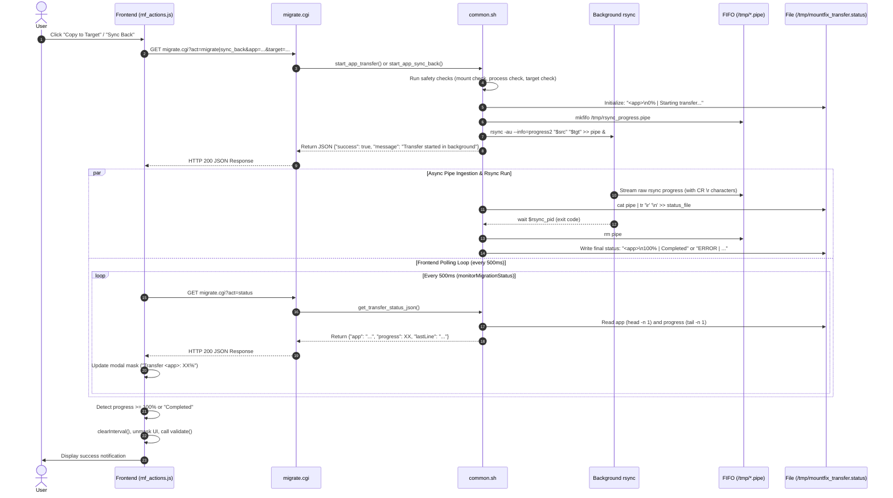

# MountFix Technical Architecture

This document describes the internal architecture, IPC mechanisms, and data flows of MountFix for ASUSTOR ADM.

---

## 1. Data Migration & Sync-Back Flow

MountFix allows copying and synchronizing application directories between the default storage volume (`/volume1/.@plugins/AppCentral/<app>`) and designated target volumes (such as fast NVMe/SSD storage at `/volumeX/AppCentral/<app>`).

Two primary transfer directions exist:
1. **Migration (HDD -> SSD):** Copies application data from `/volume1` to the target volume before establishing a bind-mount.
2. **Sync-Back (SSD -> HDD):** Safely syncs newer files from the SSD volume back to the original `/volume1` storage before maintenance, uninstallation, or volume restructuring.

### 1.1 Sequence Diagram



---

## 2. IPC & Progress Tracking Mechanism

### 2.1 Temporary Files and Paths

All transient IPC files are stored under `/tmp`:

| File Path | Type | Purpose |
| :--- | :--- | :--- |
| `/tmp/mountfix_transfer.status` | Plain Text | Contains the active transfer state, current application name, and recent rsync output. |
| `/tmp/rsync_progress.pipe` | FIFO (Named Pipe) | Intercepts stdout/stderr during migration to target volume. |
| `/tmp/rsync_syncback_progress.pipe` | FIFO (Named Pipe) | Intercepts stdout/stderr during sync-back to volume 1. |

### 2.2 Carriage Return Normalization (`tr '\r' '\n'`)

By default, `rsync --info=progress2` outputs periodic transfer progress using carriage returns (`\r`) rather than newlines (`\n`) to overwrite the console line in interactive terminals.

In a daemonized background process writing directly to a file, this would create an unsegmented continuous stream that standard UNIX line tools (`tail`, `sed`) cannot cleanly read. MountFix solves this by piping the rsync output through a named FIFO buffer and transforming carriage returns to line feeds:

```bash
cat "$pipe" | tr '\r' '\n' >> "$STATUS_FILE"
```

### 2.3 Status File Lifecycle

The status file (`/tmp/mountfix_transfer.status`) follows a two-part layout:
- **Line 1:** Target application name (e.g., `Nextcloud`).
- **Subsequent lines / Last line:** Ongoing rsync progress lines or completion marker.

1. **Initialization:**
   ```bash
   echo "$app_name" > "$STATUS_FILE"
   echo "0% | Starting transfer..." >> "$STATUS_FILE"
   ```
2. **In-Flight Updates:** Continuous progress lines appended from `cat "$pipe" | tr '\r' '\n'`, e.g.:
   ```text
   Nextcloud
   10,485,760   15%   12.50MB/s    0:00:05
   25,165,824   36%   14.20MB/s    0:00:03
   ```
3. **Completion or Failure:**
   ```bash
   echo "$app_name" > "$STATUS_FILE"
   if [ "$rsync_status" -eq 0 ]; then
       echo "100% | Completed" >> "$STATUS_FILE"
   else
       echo "ERROR | Transfer failed (exit code: $rsync_status)" >> "$STATUS_FILE"
   fi
   ```

### 2.4 Status Extraction (`get_transfer_status_json`)

When `migrate.cgi?act=status` is invoked, the backend executes `get_transfer_status_json()` in `webman/scripts/common.sh`:
- Retrieves application name from the top: `first_line=$(head -n 1 "$STATUS_FILE")`
- Retrieves the latest progress line: `last_line=$(tail -n 1 "$STATUS_FILE")`
- Extracts the percentage integer using regex:
  ```bash
  percent=$(echo "$last_line" | grep -oE '[0-9]+%' | tr -d '%' | tail -n 1)
  ```
- Emits a sanitized JSON response:
  ```json
  {"app": "Nextcloud", "progress": 36, "lastLine": "25,165,824   36%   14.20MB/s    0:00:03"}
  ```

### 2.5 Frontend Polling (`mf_actions.js`)

Communication between backend and frontend relies on periodic **HTTP GET polling** rather than WebSockets or Server-Sent Events (SSE) to ensure full compatibility with ADM's lighttpd/CGI environment.

- **Trigger:** Method `page.monitorMigrationStatus(actionLabel, callbackOnComplete)`.
- **Interval:** Fixed at `500ms` via `setInterval()`.
- **UI Feedback:** Applies an ExtJS element mask (`page.win.el.mask()`) showing the live percentage.
- **Termination Conditions:**
  - `lastLine` contains `"ERROR"`: Clears interval, unmasks UI, displays error message.
  - `progress >= 100` or `lastLine` contains `"Completed"`: Clears interval, unmasks UI, shows success, runs validation, and triggers completion callbacks.
  - AJAX failure / network error: Clears interval, unmasks UI, alerts the user.

---

## 3. Safety Guardrails & Pre-conditions

Data transfer operations enforce strict safety constraints to prevent data corruption or filesystem conflicts:

1. **Unmounted Prerequisite (`is_app_bind_mounted`):**
   - Transfer is immediately rejected if the application is currently bind-mounted. The application must be unmounted before any migration or sync-back.
2. **Process Conflict Prevention (`pgrep`):**
   - Verifies whether an existing `rsync` process is already running for the given application. Concurrent transfers for the same app are prevented.
3. **Safe Update Mode (`rsync -au`):**
   - Transfers use `-a` (archive: permissions, owners, timestamps, recursion) and `-u` (update: skips files that are newer on the destination).
   - The destructive `--delete` flag is deliberately excluded.
4. **Collision Detection & Confirmation:**
   - If the target directory already exists and contains files, the backend halts and returns `{"target_exists": true}` unless explicitly called with `force=1`.
   - The frontend prompts the user with an explicit modal confirmation before re-running with the force override.

---

## 4. Boot & Shutdown Bind-Mount Lifecycle (`S02MountFix` / `K02MountFix`)

ADM registers `CONTROL/start-stop.sh` at boot/stop priority `2` (`/usr/local/etc/init.d/S02MountFix` and `K02MountFix`):
- **Boot order (`rcS.pluginsfs`):** `S02MountFix` runs *before* relocated applications (`S20download-center`, `S50minidlna`, `S50photogallery`, `S52entware`, `S65docker-ce`).
- **Shutdown order (`rcK.pluginsfs`, sorted with `sort -r`):** `K80…` → `K52entware` → `K35docker-ce` → … → `K02MountFix`, followed later by built-in system services (`sshd` and `S21stormand`).

### 4.1 `jq`-Free Configuration (`etc/mounts.list`)

Because `S02MountFix` starts before `S52entware` (and `K02MountFix` stops after `K52entware` removes `/opt/bin`), boot and shutdown scripts cannot depend on Entware's `jq`:
- `etc/mountfix.conf` remains the JSON source of truth for the ExtJS UI.
- `generate_mounts_list()` (in `CONTROL/common.sh`) validates `targetVolume` (`^/volume[0-9]+$`) and each selected package name, and atomically writes `etc/mounts.list` (`<targetVol>/AppCentral/<app>:/volume1/.@plugins/AppCentral/<app>`, one entry per line).
- `etc/mounts.list` is regenerated automatically on every UI config save (`save_mountfix_config`) and during package `install`/`upgrade` (`CONTROL/post-install.sh`).
- At boot/shutdown, `get_mount_configs()` reads `etc/mounts.list` using pure POSIX `sh` (`while IFS=: read -r src tgt`).

### 4.2 Safe & Fast Unmount Strategy (`do_stop`)

ADM enforces a 60-second per-script shutdown timeout (`/etc/script/script_trap.sh`), and `S21stormand stop` requires all cross-volume bind mounts between `/volume2` and `/volume1` to be detached cleanly before volumes can unmount:

1. **Target Discovery (`collect_stop_entries`):** Combines configured entries from `mounts.list` with any live `/volume1/.@plugins/AppCentral/<app>` bind mounts discovered directly from `/proc/mounts`, deduplicated and reversed (`sed -n '1!G;h;$p'`).
2. **`umount`-First Fast Path:** Attempts a plain, non-lazy `umount "$tgt"` first. Idle directories unmount in `~0.01 s` without scanning `/proc`; busy mounts immediately return `EBUSY` with no side effects (lazy `umount -l` and filesystem-wide `fuser -m` are never used).
3. **Per-Path Holder Inspection (`pids_using_paths`):** Only when `umount` fails with `EBUSY`, scans `/proc/[0-9]*/{cwd,root,exe,fd/*,maps}` for exact path prefix matches on `$tgt` and `$src`, formatting holders as `pid(comm)` within a shared wall-clock budget (`STOP_MAX_SECONDS=12`).
4. **Context-Aware Handling (`/var/log/halt-action`):**
   - **Normal runtime (AppCentral stop / disable / upgrade — `halt-action` empty):** Never sends signals to running processes; logs a warning and leaves busy mounts intact so running services (e.g., Docker) continue uninterrupted.
   - **System `REBOOT` or `SHUTDOWN` (`halt-action` contains `REBOOT`/`SHUTDOWN`):** Sends `SIGTERM` (2 s grace) followed by `SIGKILL` (1 s) *only* to the exact per-path PIDs still holding the mount (e.g., lingering SSH `tmux`/`bash` sessions on `entware`), then performs a clean `umount` so `stormand` shuts down cleanly.

### 4.3 Observability & Logging

- **Persistent Log:** Every `start`/`stop` action logs timestamped entries to `/usr/local/AppCentral/MountFix/var/mountfix.log` (automatically rotated when exceeding 500 lines).
- **ADM System Event Log:** Warnings (such as skipped busy mounts or shutdown `SIGTERM` cleanup) are also emitted to ADM's system log via `/usr/sbin/syslog --log 0 --level 1 --user SYSTEM --event "[MountFix] ..."`.

---

## 5. Additional Architecture Topics

For full audit history, field findings, and the Stage 2 roadmap (UI-to-config synchronization, `rsync -aHAX` hardening, NVMe detection, and single-app validation optimization), see [docs/TECHNICAL-REVIEW.md](TECHNICAL-REVIEW.md) and [IDEAS.md](../IDEAS.md).

